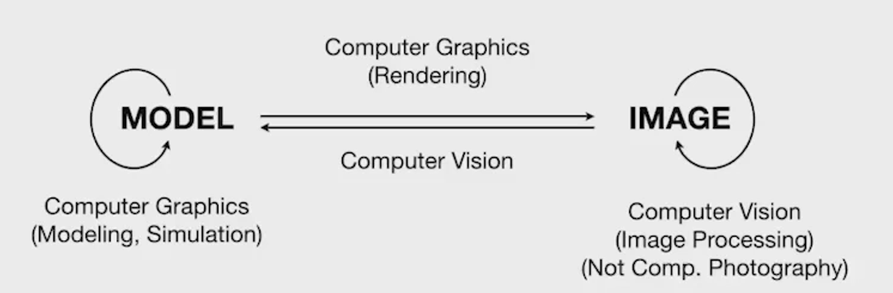

# 计算机图形学

百度百科定义：
**计算机图形学**（Computer Graphics，简称CG）是一门研究如何在计算机中表示、处理和显示图形的学科，其核心目标在于创建有效的视觉交流。
**计算机视觉**（Computer Vision，简称CV）是使用计算机及相关设备对生物视觉的一种模拟。它的主要任务就是通过对采集的图片或视频进行处理以获得相应场景的三维信息，就像人类和许多其他类生物每天所做的那样。

## 计算机图形学概述
课程主要内容：
1. 光栅化（Rasterization）
2. 曲线和曲面（Curves and Meshes）
3. 光线追踪（Ray Tracing）
4. 动画和模拟（Animation / Simulation）

+ 光栅化：三位空间地集合形体显示在屏幕上。
+ 实时：30fps（每秒30帧）。实时图形学会广泛应用到光栅化的方法。
+ 几何：如何表示光滑的曲线、曲面，简单曲线/曲面细分得到复杂曲线曲面，形变等。
+ 光线追踪：动画和电影常用，更真实的画面。慢，但是现在有实时光线追踪。
+ 动画/仿真：帧动画、小球弹跳，等等

games101不教：
+ OpenGL/DirectX/Vulcan（图形学API），学工作原理。API自己学。
+ Shader怎么写（Glsl、Hlsl等）
+ 三维建模与游戏开发（Maya、3DS MAX、Blender、Unity或Unreal Engine做的VR/Game）
+ 计算机视觉（视觉：一切需要猜测的内容，例：语义分割，生成对抗网络）

**CV和CG的区别**：

+ model to image（CG）：三维空间几何体，描述它的材质或者光照。转化成图片
+ image to model（CV）：从一张图识别出不同的模型
+ model to model（CG）：三维形体表述与仿真（沙子、油倒在面上），没经历图像
+ image to image（CV）：被很多人误叫作计算摄影学（computational photograpy）（摄像机，不同光学属性），老师认为应该叫图像处理。

边界越来越模糊。

## 线性代数复习
图形学依赖的基础知识：
- 基础数学：线性代数，微积分，统计
- 基础物理：光学（新：波动光学），力学
- 其它：信号处理，数值分析
- 一点美学

向量：三角形法则、平行四边形法则

单位向量：
$
\hat{a}=\frac{\vec{a}}{\parallel \vec{a} \parallel}
$

$
\vec{a}\cdot \vec{b}=\parallel\vec{a}\parallel \parallel \vec{b} \parallel \cos \theta \\
$
